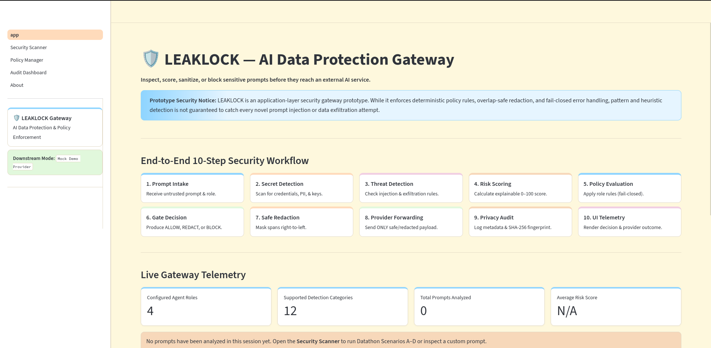
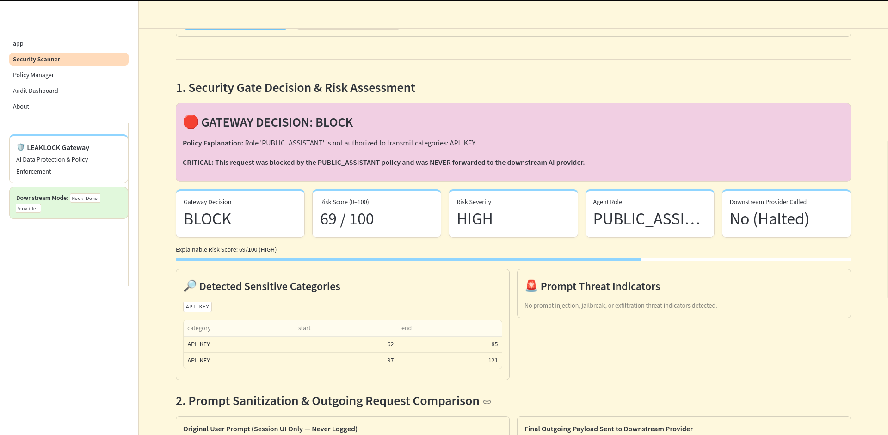
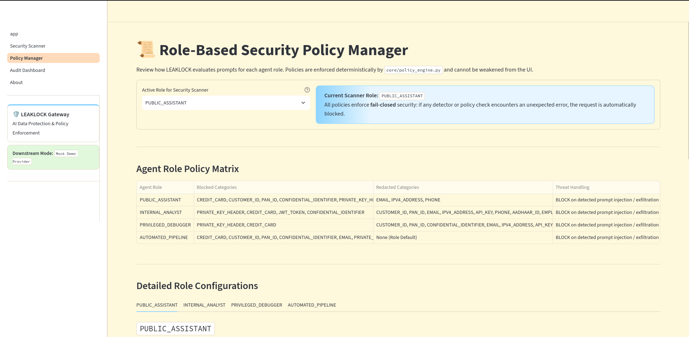
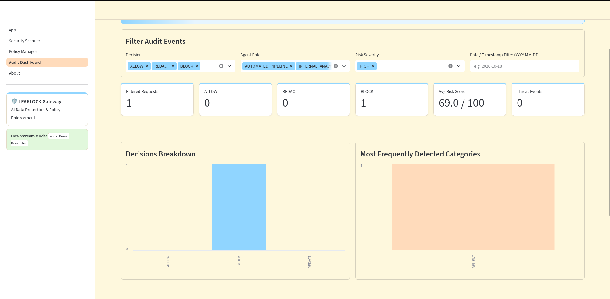

# LEAKLOCK — AI Data Protection Gateway

**Inspect. Protect. Audit.**

LEAKLOCK is a Python-based prototype that inspects AI prompts for sensitive information and suspicious patterns, evaluates risk, and applies configurable security policies.

🌐 **Live Demo:** https://leaklock.streamlit.app/  
📦 **Project Repository:** https://github.com/sujan-angadi/IBM-Datathon/tree/main/LEAKLOCK

## 📸 Screenshots

### Security Dashboard


### Security Scanner


### Policy Manager


### Audit Dashboard


## 🚨 Problem

AI prompts may contain API keys, credentials, personal information, and confidential business data. Prompt injection and attempts to extract protected information introduce additional risks.

## 💡 Solution

LEAKLOCK provides a security layer that checks prompts for sensitive data and suspicious patterns, calculates a risk score, and applies configured allow, redact, or block policies.

## ✨ Key Features

- Sensitive-data pattern detection
- Prompt threat detection
- Risk scoring
- Configurable security policies
- Interactive security scanner
- Policy management interface
- Security event audit dashboard

## ⚙️ Workflow

1. A user submits a prompt for inspection.
2. LEAKLOCK checks for sensitive information and suspicious patterns.
3. The system evaluates the potential risk.
4. Configured policies determine whether the request is allowed, redacted, or blocked.
5. Relevant security events can be reviewed in the audit interface.

## 🧰 Technology Stack

- Python
- Streamlit
- Regular expressions
- Rule-based policy engine
- Risk scoring and audit logging

## 🚀 Run Locally

```bash
git clone https://github.com/sujan-angadi/IBM-Datathon.git
cd IBM-Datathon/LEAKLOCK
python3 -m venv .venv
source .venv/bin/activate
python -m pip install -r requirements.txt
streamlit run app.py
```

## 🔐 Security Limitations

LEAKLOCK is a prototype, not a guarantee against all AI security threats. Detection rules may miss unknown attacks or flag legitimate prompts. It should not be the sole security control for production systems.

## 🖥️ IBM LinuxONE Relevance

LinuxONE is a potential environment for future deployment and validation. Planned work includes running LEAKLOCK and its tests on LinuxONE and evaluating compatibility and performance. Full integration remains future work unless separately demonstrated.

## 🎯 Goal

Explore how an AI data protection gateway can help users and organizations identify risky prompts and reduce accidental exposure of sensitive information.
